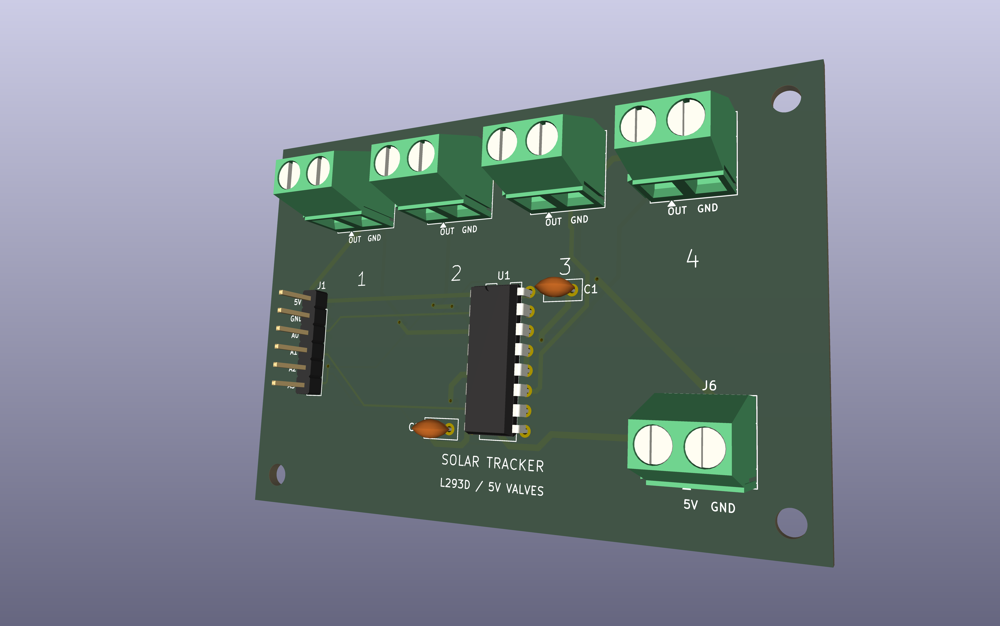
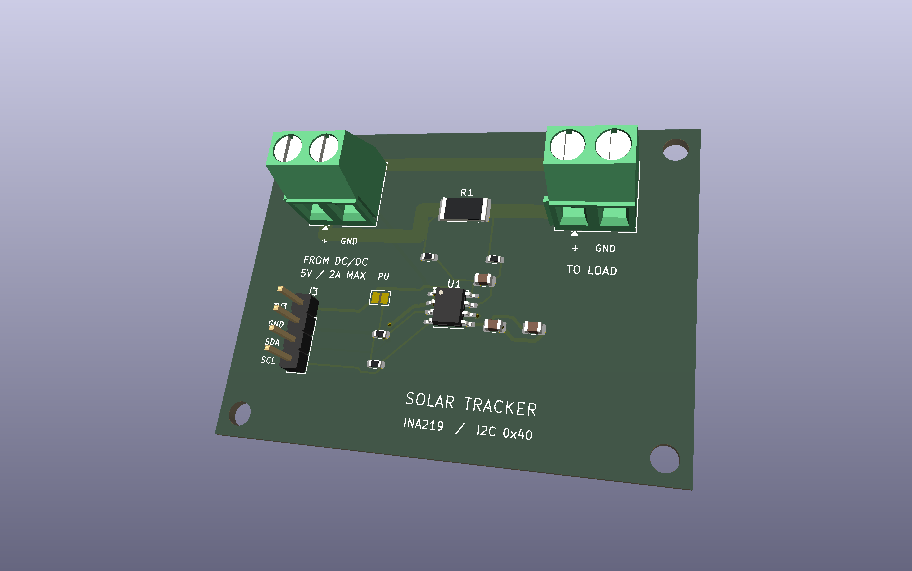

# Solar Tracker (Arduino UNO Q)

App per Arduino App Lab: pannello a 2 assi (azimut + pitch) che insegue il sole,
si apre quando alla pianta che ha sotto arriva poca luce (fotoresistore),
riconosce la pianta e il suo stato di salute da una foto e la innaffia dal
serbatoio di raccolta quando ne ha bisogno. Una pagina web mostra tutto e
permette di muovere il pannello a mano.

```
app.yaml               nome dell'app e brick WebUI
sketch/sketch.ino      microcontrollore: sensori, servo, LED, valvola, sicurezza
sketch/sketch.yaml     librerie
assets/index.html      pagina web (porta 7000)
python/main.py         avvio dell'app sul lato Linux
python/config.py       TUTTA la taratura (coordinate, meccanica, soglie)
python/controller.py   logica di decisione
python/tracker.py      collega telemetria, meteo, modelli, servo e pagina web
python/webui.py        indirizzi della pagina web (/state, /photo, /manual, /auto)
python/solar.py        posizione del sole e ricerca della posa migliore
python/weather.py      previsioni Open-Meteo con cache
python/ai_model.py     interfaccia verso i due modelli AI + sostituti simulati
python/colleague_model.py  carica i modelli ONNX veri da python/models/
python/requirements.txt    librerie Python in più (onnxruntime)
python/irrigation.py   quando e quanto innaffiare
python/demo.py         giornata simulata per le dimostrazioni
python/devices.py      camera della pianta
python/plants.py       profili delle piante (acqua, luce minima, temperatura)
tests/test_logic.py    prove della logica su PC, senza scheda
3d models/             supporto del pannello e scatole da stampare (STEP, STL) + render/
hardware/              schede valvole e INA: schematici, PCB KiCad e render PNG
```

## Tecnologie usate

| Parte | Tecnologia |
|---|---|
| Scheda | **Arduino UNO Q**: microcontrollore STM32U585 (sketch su Zephyr) + processore Qualcomm QRB2210 con Linux (lato Python), sulla stessa scheda |
| Ambiente | **Arduino App Lab**: un'app = sketch + Python + pagina web (`app.yaml`), brick `arduino:web_ui` |
| Microcontrollore | C++ Arduino; driver PWM di **Zephyr** sul timer TIM4 per i servo; I2C software per i sensori |
| Collegamento MCU ↔ Linux | **Arduino_RouterBridge** (chiamate RPC e notifiche in MsgPack) |
| Lato Linux | **Python 3**: libreria standard più `numpy` e `onnxruntime` |
| Pagina web | HTML, CSS e JavaScript senza librerie, servita dal brick WebUI sulla porta 7000 |
| Meteo | API **Open-Meteo** (gratuita, senza chiave), con cache su disco |
| Posizione del sole | calcolo astronomico in `solar.py`, nessun servizio esterno |
| Intelligenza artificiale | due modelli **MobileNetV3-Small** in formato **ONNX**, eseguiti con **ONNX Runtime** (OpenCV come ripiego) |
| Sensori e moduli | Grove Base Shield, 2× Grove **AHT20** (temperatura e umidità), fotoresistore, servo **SG90**, camera USB |
| Meccanica | parti progettate in CAD (STEP) e scatole in STL, stampate in 3D |

## Pinout

**La UNO Q lavora a 3,3 V.** Molti pin digitali sopportano 5 V in ingresso, ma non D3, A0 e A1
(massimo 3,6 V) né gli altri pin analogici quando leggono.

### Con il Grove Base Shield (Seeed), interruttore su 5V

Lo sketch è impostato così (`SHIELD_5V 1`). A 5 V vale una regola: **niente che mandi un
segnale sul pin D3 e niente segnali analogici**. Per questo l'AHT20 della pianta non sta sulla
porta D2 e il fotoresistore si legge dalla sua uscita digitale.

| Porta dello shield | Filo giallo | Filo bianco | Note |
|---|---|---|---|
| **I2C** (una qualsiasi) | AHT20 n.1 "aria esterna", cavo Grove intero | | SDA/SCL (D20/D21), I2C via software |
| **D2** | fotoresistore, uscita **DO** (D2) | **non collegare** (è D3) | rosso → VCC, nero → GND del modulino. AO resta scollegato |
| **D4** | AHT20 n.2 "sotto il pannello", cavo Grove intero | | D4 = SCL, D5 = SDA, I2C via software |
| **D6** | LED luce pianta (D6) | LED meteo (D7) | |
| **D8** | LED stato (D8) | | |
| **A0** | valvole, linea 1 (A0) | linea 2 (A1) | verso l'integrato pilota |
| **A2** | valvole, linea 3 (A2) | linea 4 (A3) | verso l'integrato pilota |
| pin della scheda | servo azimut: **D9** segnale · servo pitch: **D10** segnale | | rosso e marrone all'alimentazione 5 V separata |
| **USB-C** | alimentazione, camera USB | | lato Linux |

Previsti nel firmware ma non collegati: galleggiante (D13), umidità del
terreno (A4, solo a 3,3 V), INA219 (porta I2C).

- I due AHT20 hanno lo stesso indirizzo fisso (0x38): uno sulle porte I2C, l'altro sulla porta D4.
- Il fotoresistore a 5 V dà solo luce o buio; la soglia è la vite blu del modulino. Per avere
  la percentuale serve l'uscita AO su A1, quindi il modulino a 3,3 V oppure un partitore
  (AO → 10 kΩ → A1 → 20 kΩ → GND) e `LIGHT_DIGITAL 0` nello sketch.
- Sui fili rossi dei cavi Grove ci sono 5 V: ai LED non vanno collegati.
- Con l'interruttore su 3.3V: `SHIELD_5V 0`, AHT20 della pianta sulla porta D2, fotoresistore
  con AO su A1.

### LED

Accesi a livello alto. LED nudi: resistenza da 330 Ω – 1 kΩ in serie, catodo a GND.
Chi non serve si disattiva mettendo `-1` al posto del pin nello sketch.

| LED | Pin | Significato |
|---|---|---|
| Stato | D8 | 1 lampo ogni 2 s = tutto ok · 2 lampi = manca un AHT20 · lampeggio veloce = il lato Linux non sta comandando |
| Linee 1–4 | A0, A1, A2, A3 | nella scatola delle valvole: acceso = linea aperta. Sono le uscite vere delle elettrovalvole |
| Luce pianta | D6 | fisso = pannello aperto per dare luce alla pianta · lampeggiante = comando manuale dalla pagina web |
| Meteo | D7 | fisso = piove · lampeggio veloce = sicurezza vento |

Ci sono anche un LED per ciascun asse (`PIN_LED_AZ`, `PIN_LED_PITCH`), spenti di default:
con i servo montati il movimento si vede direttamente.

### Servo ed elettrovalvole

I servo sono pilotati dal timer hardware della scheda (PWM su D9/D10), senza la
libreria Servo, che su questa scheda blocca lo sketch. Solo D9 e D10 hanno quel
timer: su altri pin servirebbe `SERVO_USE_HW_PWM 0` e i servo andrebbero a scatti.

| Filo SG90 | Servo azimut (base) | Servo pitch (inclinazione) |
|---|---|---|
| arancione (segnale) | **D9** | **D10** |
| rosso (+5 V) | +5 V dell'alimentazione separata | +5 V dell'alimentazione separata |
| marrone (GND) | GND dell'alimentazione separata | GND dell'alimentazione separata |

- L'alimentazione separata deve dare 5 V e almeno 2 A. Il suo GND va collegato anche
  a un GND della scheda, altrimenti il segnale non ha riferimento.
- Mai dal 3V3 né dai fili rossi delle porte Grove.
- Un elettrolitico da 470–1000 µF tra 5 V e GND vicino ai servo evita i reset quando partono.
- All'avvio solo il servo di azimut fa la prova 20° → 70° → 20° (`SERVO_SELF_TEST`). Il
  pitch resta fermo: la sua corsa è limitata dal pannello.
- Il pitch è montato al contrario: `PITCH_SERVO_REVERSED 1` nello sketch inverte l'impulso
  (180° − angolo). Il resto del programma usa gli stessi gradi.
- Il servo non sa se sbatte (non ha un ritorno di posizione). La protezione è la corsa
  tarata a mano nello sketch, in gradi della pagina: **135°** = pannello in piano, **65°** =
  alzato al massimo (70° di inclinazione), **150°** = inclinato di 15° dall'altra parte
  (`PITCH_MIN_DEG` / `PITCH_MAX_DEG` = 65 / 150). La scheda rifiuta qualunque angolo fuori corsa, sia da
  Linux sia dalla pagina. Se si rimonta la squadretta del servo, va rifatta la taratura.

Elettrovalvole: quattro linee, su A0, A1, A2 e A3. I pin danno 3,3 V e pochi mA,
quindi comandano solo l'integrato pilota sulla millefori (oggi accende 4 LED,
domani le valvole vere con lo stesso circuito); le valvole hanno la loro
alimentazione. Livello alto = linea aperta (`VALVE_ACTIVE_HIGH`). Con le valvole
vere servono un diodo di ricircolo su ogni bobina, se l'integrato non li ha già,
e valvole che aprano **a pressione zero** (ad azione diretta): con un serbatoio
a caduta molte valvole da irrigazione a 12 V non aprono.

## Alimentazione

```
pannello → step-down → HW-736 → batteria LiPo 3,7 V → convertitore boost 5 V → pin 5V della UNO Q + servo
```

- La UNO Q vuole **5 V stabili, almeno 3 A** (pin 5V o USB-C; in alternativa 7–24 V su VIN).
- L'HW-736 risulta essere un caricatore CN3065: in uscita dà la tensione della
  batteria (3,7–4,2 V), non 5 V, quindi serve un boost a 5 V tra batteria e scheda.
- Lo stesso modulo carica al massimo a 500 mA (circa 2 W): da verificare contro il
  consumo della scheda, che è un computer Linux.
- Alimentando dal pin 5V, la porta USB-C resta libera per la camera.

## Componenti simulati

| Componente | Dove | Come si passa a quello vero |
|---|---|---|
| Elettrovalvole | `sketch.ino` | le uscite funzionano già (LED). Con le valvole vere `#define HAS_VALVE 1`: cambia solo la scritta sulla pagina |
| Sensore di terreno | `sketch.ino` | `#define HAS_SOIL_SENSOR 1` e taratura `SOIL_RAW_DRY` / `SOIL_RAW_WET`. Senza, il fabbisogno è stimato |
| Galleggiante | `sketch.ino` | `#define HAS_TANK_SENSOR 1`. Senza, il livello del serbatoio è stimato dalla pioggia |
| INA219 | `sketch.ino` | niente: viene rilevato da solo all'indirizzo 0x40. Finché manca, la potenza è *stimata* dal modello solare |
| Fotoresistore | `sketch.ino` | è attivo; se non è montato `#define HAS_LIGHT_SENSOR 0` |

## Pagina web

Con l'app in esecuzione: `http://<nome-della-scheda>.local:7000`. Ha due pagine.

**Impianto**
- **Pannello** (riquadro scuro): modalità, motivo, disegno di sole e pannello, copia dei LED.
- **La pianta**: si carica una foto, i due modelli dicono che pianta è e come sta.
  Il tipo imposta il profilo (acqua, luce minima); se ha sete parte subito un'innaffiatura.
- **Luce alla pianta**: lettura del fotoresistore rispetto al minimo della pianta.
- **Irrigazione**: sete, serbatoio, acqua erogata, stato delle quattro linee e comando
  a mano (si scelgono le linee e i secondi, al massimo 60; si richiudono da sole o
  con "Chiudi tutto"; non vale la pausa di 5 minuti dell'automatico, resta il
  blocco a serbatoio vuoto).
- **Le mie piante** (mockup): una scheda per pianta, una per linea (`GARDEN` in
  `config.py`). Per ognuna: luce, temperatura e acqua giudicate con i sensori montati
  (il fotoresistore contro la luce minima della pianta, l'AHT20 sotto il pannello contro la
  sua temperatura massima, il sensore di terreno se c'è, altrimenti la sete stimata), il
  fabbisogno di oggi e la **prossima innaffiatura stimata**: consumo scalato con l'aria secca,
  dose divisa per linea, pausa minima, rimandata fuori dalle ore calde salvo urgenza, bloccata
  a serbatoio vuoto. È una stima: per ora l'acqua vera segue la pianta riconosciuta dalla foto,
  con la dose divisa tra le quattro linee.
- **Muovi il pannello a mano**: due cursori e pose rapide. Torna in automatico con
  il pulsante o dopo 10 minuti (`MANUAL_TIMEOUT_S`). Il vento forte vince comunque.

**Prova componenti** (per il banco, non per la demo)
- "Avvia la prova" ferma l'automatismo (anche la sicurezza vento) e tiene sveglia
  la scheda; si chiude con il pulsante o da sola dopo 10 minuti (`DEBUG_TIMEOUT_S`).
- **Servo**: angolo diretto del servo, senza passare dai calcoli del sole. Azimut 0–180°,
  pitch 65–150° (la corsa tarata, 135° = in piano).
- **Elettrovalvole**: una linea alla volta, tutte insieme o una dopo l'altra, 3 secondi l'una.
- **LED**: accende un LED alla volta (stato, pianta, meteo), tutti, o in sequenza.
- **Sensori**: valori in diretta dei due AHT20, del fotoresistore e
  dei componenti facoltativi, ognuno con "risponde", "non risponde" o "non montato".
- **Fotoresistore**: lettura grezza e taratura (buio, piena luce).
- **Camera e modelli**: scatto di prova e stato dei due modelli (vero o simulato).
- **Scheda**: età degli ultimi dati, a che punto è lo sketch, ultimi messaggi `[MCU]`.

I comandi partono subito: la pagina sveglia il ciclo del lato Linux. I servo però si
muovono a rampa, 30°/s (`SERVO_SPEED_DEG_S`).

## Modelli AI

Le cartelle dei modelli sono incluse nel progetto: [PlantWatch](ai-models/plantwatch/README.md)
per la condizione della pianta e [PlantNet-300K](ai-models/plantnet300k-mobilenetv3-small/README.md)
per la specie. L'[overview AI](ai-models/README.md) riporta dataset, accuracy, dimensioni e
stato dell'integrazione. Il loader usa PlantWatch per la salute e PlantNet-300K
per la specie.


Due modelli ONNX in `python/models/`, dichiarati in `config.py` (`HEALTH_MODEL_*`,
`PLANT_MODEL_*`). Entrambi sono MobileNetV3-Small con ingresso 224×224; le foto
vengono normalizzate con i valori ImageNet (`MODEL_MEAN`, `MODEL_STD`).
PlantWatch usa il ridimensionamento bilineare diretto a 224×224; il riconoscitore
di specie mantiene il lato corto a 256 e il ritaglio centrale a 224.

- **Tipo di pianta** (`plantnet_mobilenetv3.onnx`): 1081 specie del dataset
  Pl@ntNet-300K. I nomi scientifici sono in `plantnet_labels.txt`, uno per riga
  nell'ordine delle uscite (id di specie in ordine crescente, come nel codice
  ufficiale del dataset). **Non conosce basilico, pomodoro, peperone, spinacio**;
  conosce per esempio fragola, lattuga, zucca e zucchina, lavanda, geranio,
  calendula, tagete, piante grasse (Sedum, Lithops, cactus), felci e molte piante
  da interno (Anthurium, Alocasia, Peperomia, Fittonia, Zamioculcas, Schefflera,
  Tradescantia). Se la specie è incerta ma il genere è sicuro, vale il genere.
  Il profilo (acqua, luce, temperatura) si sceglie dal genere: tabella `GENUS`
  in `plants.py`; un genere senza profilo usa i valori generici.
- **Salute — PlantWatch** (`plantwatch.onnx`): due uscite, nell'ordine
  `healthy` (0) e `wilted` (1), confermato da `plantwatch.json`. Il modello è
  addestrato su Houseplants e usa `HEALTH_MODEL_DIRECT_RESIZE = True`.
- `HEALTH_OK_KEYWORDS` e `HEALTH_THIRSTY_KEYWORDS` dicono quali etichette
  significano "sana" e "ha sete" (quest'ultima fa partire un'innaffiatura).
- Per eseguire i modelli servono `onnxruntime` e `Pillow`, elencati in
  `python/requirements.txt` (App Lab lo installa al primo avvio, serve la rete).
  Se manca si prova con OpenCV; se non c'è nemmeno quello i modelli restano
  simulati, e la pagina lo scrive.

## Logica

A ogni decisione, in ordine di priorità:

1. **SICUREZZA** – raffica prevista ≥ 10 m/s: pannello piatto per almeno 10 minuti.
2. **MANUALE** – posa scelta dalla pagina web.
3. **NOTTE** – piatto.
4. **LUCE_PIANTA** – il fotoresistore legge meno del minimo della pianta
   (`light_min_pct` in `plants.py`): il pannello si apre un passo alla volta, da
   puntato al sole a messo di taglio, così la luce passa. Quando la luce supera
   il minimo + `LIGHT_HYSTERESIS_PCT`, o sotto il pannello fa più caldo del
   massimo della pianta, si richiude un passo alla volta.
5. **PRODUZIONE** – posa che massimizza l'irraggiamento previsto sul pannello:
   col sereno insegue il sole, col coperto si mette quasi piatto, con la pioggia
   resta inclinato almeno 10° per far scolare l'acqua.

La pioggia prevista viene confermata dall'umidità dell'AHT20 esterno. Se il lato
Linux smette di rispondere per 5 minuti il microcontrollore porta il pannello
in piano da solo.

Taratura della luce, dalla pagina web (riquadro "Luce alla pianta"): coprire il
sensore e premere "adesso è buio", scoprirlo e premere "adesso è piena luce". Da
lì la scala va da 0 (buio) a 100 (piena luce) qualunque sia il modulino, anche
se legge al contrario; resta salvata tra un avvio e l'altro. Le soglie delle
piante (`light_min_pct` in `plants.py`) sono percentuali di questa scala.

## Dimostrazione e basso consumo (`config.py`)

- `DEMO_MODE = True`: sole e meteo simulati, una giornata in circa 4 minuti
  (sereno, coperto, pioggia, raffiche). Sensori, fotoresistore, servo e LED sono
  quelli veri. **Rimettere `False` per l'uso reale.**
- `LOW_POWER_MODE = True` (vale solo con `DEMO_MODE = False`): l'impianto si
  sveglia ogni `WAKE_PERIOD_S` (30 minuti), legge i sensori, guarda le previsioni,
  decide, muove il pannello puntando dove sarà il sole a metà intervallo, poi
  toglie il segnale ai servo, spegne i LED e ferma le letture. Una foto o un
  comando manuale dalla pagina lo svegliano subito. Il processore Linux della
  scheda resta acceso: si risparmia su servo, LED e microcontrollore.

## Irrigazione

Il fabbisogno dipende dalla pianta riconosciuta (`water_ml_day` in `plants.py`).

- **Senza sensore di terreno**: bilancio idrico. Il fabbisogno giornaliero viene
  scalato con la secchezza dell'aria misurata dall'AHT20 sotto il pannello e si
  eroga una dose (150 ml) ogni volta che il debito accumulato la raggiunge.
- **Con il sensore di terreno**: si innaffia sotto la soglia `soil_min_pct` della pianta.
- Si evita il pieno sole (si rimanda alla sera, salvo urgenza), si aspetta
  30 minuti tra due dosi e non si supera il doppio del fabbisogno giornaliero.
- Il serbatoio si riempie con la pioggia (`COLLECTOR_AREA_M2`); a serbatoio vuoto
  non si apre e il log avvisa.
- Le linee sono quattro (`VALVE_LINES`): a ogni innaffiatura la dose viene divisa
  tra le linee, aperte una dopo l'altra.
- Sul microcontrollore ogni linea si richiude comunque da sola: al massimo 60 s
  per apertura e 5 minuti di pausa tra due aperture, anche se Linux si blocca.

Da tarare: `VALVE_FLOW_ML_S` (portata reale di una linea aperta), capienza del
serbatoio e superficie di raccolta. `RAIN_ON_PLANT_FRACTION` dice quanta pioggia
arriva alla pianta: è 0, cioè il pannello la copre.

## Diagnostica

Lo sketch non usa il monitor seriale: manda i suoi messaggi al lato Linux, che li
scrive nella console Python con il prefisso `[MCU]` (stato dei componenti ogni 30 s).
Se la telemetria non arriva, la console Python dice a che punto dell'avvio si è
fermato lo sketch.

## Configurazione

Tutta la taratura sta in due file: `sketch/sketch.ino` per il microcontrollore e
`python/config.py` per il lato Linux. Alcuni valori esistono in tutti e due e vanno
cambiati insieme (indicati con ↔).

### Sketch (`sketch/sketch.ino`)

| Impostazione | Valore | A cosa serve |
|---|---|---|
| `SHIELD_5V` | 1 | interruttore del Grove Base Shield su 5V (0 = su 3.3V, cambia la piedinatura) |
| `HAS_SERVO_AZ`, `HAS_SERVO_PITCH` | 1, 1 | servo montati; con 0 l'asse è simulato |
| `AZ_DETACH_IDLE`, `PITCH_DETACH_IDLE` | 1, 0 | stacca il segnale ad asse fermo; il pitch resta in tensione per reggere il pannello |
| `SERVO_USE_HW_PWM` | 1 | impulsi dal timer TIM4 (solo D9/D10); 0 = dal loop, a scatti |
| `SERVO_SELF_TEST` | 1 | prova 20° → 70° → 20° all'avvio, solo sull'azimut |
| `AZ_MIN_DEG`/`AZ_MAX_DEG` | 0 / 180 | corsa del servo di base |
| `PITCH_MIN_DEG`/`PITCH_MAX_DEG` | 65 / 150 | corsa tarata del pitch (↔ `TILT_MAX_DEG` / `TILT_MIN_DEG`) |
| `AZ_SERVO_REVERSED`, `PITCH_SERVO_REVERSED` | 0, 1 | servo montato al contrario: impulso a 180° − angolo |
| `SERVO_US_MIN`/`SERVO_US_MAX` | 500 / 2400 µs | larghezza dell'impulso a 0° e 180° (SG90) |
| `SERVO_SPEED_DEG_S` | 30 | velocità della rampa (↔ `SERVO_SPEED_DEG_S`) |
| `PLANT_AHT_ON_SOFT_I2C` | 1 | AHT20 della pianta sulla porta D4 (0 = connettore Qwiic) |
| `MAIN_I2C_SOFT` | 1 | porte I2C dello shield in I2C software (non serve pull-up esterno) |
| `HAS_LIGHT_SENSOR`, `LIGHT_DIGITAL` | 1, = `SHIELD_5V` | fotoresistore montato; a 5 V si legge solo l'uscita DO |
| `HAS_VALVE` | 0 | 0 = LED al posto delle valvole (cambia solo la scritta sulla pagina) |
| `VALVE_ACTIVE_HIGH` | 1 | livello alto = linea aperta |
| `VALVE_MAX_OPEN_MS`, `VALVE_MIN_PAUSE_MS` | 60 s, 5 min | protezioni delle valvole, valide anche se Linux si blocca |
| `HAS_SOIL_SENSOR`, `HAS_TANK_SENSOR` | 0, 0 | sensore di terreno e galleggiante (oggi stimati) |
| `PIN_LED_*` | vedi Pinout | `-1` = LED non montato |
| `COMMS_TIMEOUT_MS` | 5 min | senza comandi da Linux il pannello va in posa di sicurezza |

### Lato Linux (`python/config.py`)

| Gruppo | Impostazioni | Valori attuali |
|---|---|---|
| Luogo | `LATITUDE`, `LONGITUDE` | Roma (41,90; 12,50) |
| Azimut | `AZ_REF_DEG`, `AZ_SERVO_AT_REF`, `AZ_SERVO_DIR`, `AZ_SERVO_MIN/MAX` | servo a 90° = pannello verso sud; corsa 0–180 = da est a ovest |
| Pitch | `PITCH_SERVO_AT_FLAT`, `PITCH_SERVO_DIR`, `TILT_MIN_DEG`, `TILT_MAX_DEG` | servo 135° = in piano, direzione −1 (si alza scendendo verso 65°), inclinazione da −15° a 70° |
| Movimento | `MOVE_DEADBAND_DEG`, `SERVO_SPEED_DEG_S` | 1,5°; 30°/s |
| Pioggia | `RAIN_NOW_MM_H`, `RAIN_CONFIRM_RH`, `RAIN_SOON_PROB`, `RUNOFF_TILT_DEG` | 0,3 mm/h; 75 % UR; 70 %; 10° |
| Vento | `WIND_STOW_MS`, `WIND_RELEASE_MS`, `STOW_HOLD_S`, `STOW_TILT_DEG` | raffica 10 m/s → piatto per almeno 10 minuti, si rilascia sotto 7 m/s |
| Notte | `NIGHT_ELEVATION_DEG`, `NIGHT_TILT_DEG` | sole sotto −1° → piatto |
| Meteo | `WEATHER_REFRESH_S`, `WEATHER_MAX_AGE_S` | ogni 30 minuti, validità 6 ore |
| Luce alla pianta | `PLANT_LIGHT_ENABLED`, `LIGHT_STEP`, `LIGHT_HYSTERESIS_PCT` | attiva, un quarto di corsa per decisione, isteresi 15 punti |
| Modelli AI | `HEALTH_MODEL_*`, `PLANT_MODEL_*`, `MODEL_*`, `*_KEYWORDS`, `*_MIN_CONFIDENCE` | vedi "Modelli AI" |
| Le mie piante | `GARDEN` | basilico, pomodoro, fragola, lavanda (linee 1–4): **da cambiare con le tue** |
| Irrigazione | `VALVE_LINES`, `VALVE_FLOW_ML_S`, `WATER_DOSE_ML`, `WATER_MAX_OPEN_S`, `WATER_MIN_INTERVAL_S`, `WATER_DAILY_CAP_FACTOR` | 4 linee, 10 ml/s (**da misurare**), 150 ml a dose, max 60 s, pausa 30 minuti |
| Serbatoio | `TANK_CAPACITY_ML`, `COLLECTOR_AREA_M2`, `COLLECTOR_EFFICIENCY`, `RAIN_ON_PLANT_FRACTION` | 5 l; la pianta non riceve pioggia (0) |
| Cadenze | `DECISION_PERIOD_S`, `MANUAL_TIMEOUT_S`, `DEBUG_TIMEOUT_S` | una decisione al minuto; manuale e prova durano al massimo 10 minuti |
| Basso consumo | `LOW_POWER_MODE`, `WAKE_PERIOD_S` | attivo, risveglio ogni 30 minuti (solo fuori dalla demo) |
| Dimostrazione | `DEMO_MODE`, `DEMO_SPEED`, `DEMO_STEP_S` | **attiva**: una giornata in circa 4 minuti |
| Camera | `PLANT_CAMERA_SOURCE` | prima camera USB trovata |

`TILT_MIN_DEG` negativo vuol dire che il pannello si inclina anche dall'altra parte (fino a
15°): il programma può scegliere quelle pose se rendono di più. Con al massimo 70° di inclinazione, a mezzogiorno d'estate il
pannello non riesce a mettersi del tutto di taglio: per la luce alla pianta si avvicina il più
possibile.

## Modelli 3D

Nella cartella `3d models/`, con i render in `3d models/render/`. Misure in millimetri.

**Supporto del pannello** (STEP, da aprire nel CAD ed esportare per la stampa)

| | | |
|---|---|---|
|  |  |  |
| `01_Base_palo.step` · 90 × 70 × 90<br>base fissata al palo | `02_Forcella_rotante.step` · 37 × 35 × 83<br>gira attorno al palo (azimut) | `03_Telaio_pannello_90x60.step` · 97 × 67 × 21<br>telaio del pannello 90 × 60, si inclina (pitch) |

**Scatole** (STL, pronte per lo slicer)

| | | |
|---|---|---|
|  |  | |
| `scatola1_arduino_corpo.stl` · 80 × 62 × 43<br>scatola della UNO Q con lo shield | `scatola1_arduino_coperchio.stl` · 80 × 62 × 5 | |
|  |  | |
| `scatola2_led_corpo.stl` · 50 × 40 × 28<br>scatola della scheda dei LED e delle valvole, fatta dalla collega | `scatola2_led_coperchio.stl` · 47 × 37 × 6 | |

**Schede elettroniche** (progetti KiCad in `hardware/`)

| Controllo elettrovalvole | Monitor tensione e corrente |
|---|---|
|  |  |
| [Progetto KiCad](hardware/valve-controller/valve-controller.kicad_pro) · 80 × 55 mm<br>L293D, quattro canali per elettrovalvole a 5 V, numerati da 1 a 4. [Collegamenti](schema.md). | [Progetto KiCad](hardware/ina-panel-monitor/ina-panel-monitor.kicad_pro) · 60 × 45 mm<br>INA219 dopo il DC/DC: ramo a 5 V, limite di progetto 2 A, I²C a 3,3 V. [Documentazione](hardware/ina-panel-monitor/README.md). |

## Prove

```
python tests/test_logic.py
python tests/test_models.py
```

Girano su PC con Python 3.10 o successivo, microcontrollore e meteo simulati.
`test_models.py` richiede le dipendenze di `python/requirements.txt` e controlla
preprocessing, etichette, foto con EXIF e inferenza PlantWatch reale.
